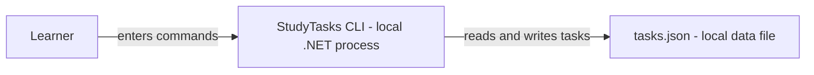
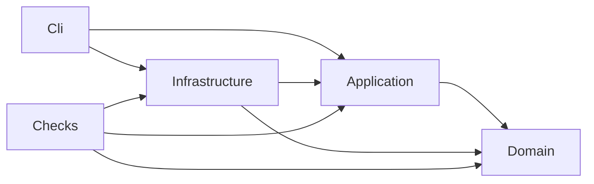
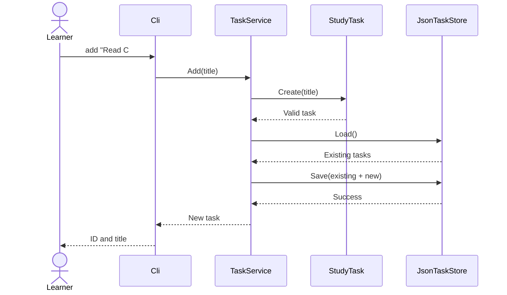

# See the architecture from different angles

Start with the ready-made pictures:

- [Dependency map](Diagrams/dependencies.svg): project references, with arrowheads pointing to the dependency.
- [Request journey](Diagrams/request-flow.svg): the steps taken to add a task.

Open either SVG in your browser. It works offline and can be zoomed or printed. These are two views of the same example, not competing designs.

## 1. Context: who uses the system?

```text
Learner -- enters commands / reads results --> StudyTasks
```

The boundary is the entire application. The first release has one local user and no remote service. A file inside the application is an implementation detail, so it is omitted from this view.

## 2. Containers: what runs and where is data stored?

In the C4 model a container means a running application or data store; it does not necessarily mean a Docker container. Our local system contains a .NET CLI and a JSON data file.



Label this a simplified C4-style container view. Name the technology and relationship. Add a browser or API only if the design actually includes one.

## 3. Source dependencies: who must know about whose types?



The Cli project uses Domain types through its transitive Application reference. The example .csproj files define direct references; the Domain project references no other example project. Checks does not reference Cli; exercise the command line separately with the documented commands.

The important question is whether a policy depends on a replaceable detail. TaskService knows ITaskStore, while JsonTaskStore supplies the implementation.

## 4. Runtime: what happens for one request?



For a blank title, validation throws before Load or Save. For a write failure, the command reports failure rather than success. Exercise: sketch those two alternate paths.

## How to read and maintain a diagram

1. Read its title, scope, legend, and arrow meanings.
2. Follow one use case. Ask what data crosses each arrow.
3. Match a box to an actual file or process.
4. Mark assumptions: one user, one process at a time, trusted local storage.
5. Update the diagram when those assumptions or dependencies change.

Mermaid snippets render on supported Markdown viewers; otherwise use the [official Mermaid editor](https://mermaid.live/). The SVG pictures require no Mermaid support. C4's [official diagram guide](https://c4model.com/diagrams) explains the zoom levels; use only the views that clarify your design.
